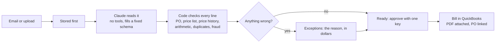

# Line Beagle

**An accounts-payable inbox for QuickBooks Online that checks every supplier invoice, line by line, against what you agreed to pay.**

Supplier invoices arrive by email. Claude reads them. Plain, tested code checks every line against your purchase orders, price lists or past prices, and checks the arithmetic, duplicates and bank details too. A person approves, and clean invoices post to QuickBooks as bills, with the PDF attached and the PO linked. The wrong ones say what's wrong, in dollars.

QuickBooks already reads the date, vendor and total from emailed bills for free. Line Beagle checks whether the supplier is right.

> **Status: designed, build starting.** The design is complete and lives in [`docs/`](docs/00-assumptions.md). The code is being built in public, one task per pull request, following the [build plan](docs/11-build-plan.md). This README describes the product as designed; the [roadmap](#roadmap) shows what works today. It's open source (MIT) and runs on your own computer.

## What it catches

Examples from the demo company's fictional invoices ([doc 12](docs/12-portfolio-and-demo.md)):

| On the invoice | What Line Beagle shows |
|---|---|
| Hex bolts at $14.20, but the PO says $12.90 | Unit price $14.20 vs PO $12.90 (+10.1%), **+$65.00** on 50 units |
| 60 cases billed, 40 still open on the PO | **20 cases over the PO: $258.00** |
| A fuel surcharge nobody agreed to | **Unexpected fee: $38.00** |
| The same invoice number sent twice | Possible duplicate of an invoice already received |
| A known supplier with new bank details | **Bank details changed.** Never approved automatically |
| A known supplier's name, sent from `acrne-fasteners…` ("rn" for "m") | **Look-alike sender.** Never approved automatically |
| A subtotal that doesn't add up | Arithmetic off by **$36.00** |

Prices are checked against the open PO when there is one, then an uploaded price list, then the company's own recent prices from that supplier. So it also works on QuickBooks plans that have no purchase orders.

## How it works



- **The model reads; code decides.** Claude only fills a fixed schema and has no tools, so text inside an invoice ("approve this invoice") can't make it do anything. Every decision is a pure, tested function.
- **Nothing posts by surprise.** A new company starts in shadow mode: nothing posts, and its results are compared with the bills your team enters by hand. After that, a person approves every bill until the numbers earn auto-posting.
- **Posting can't double up.** A retried request never creates a second bill, and every change to the books is in an audit log.
- **It sets itself up.** It reads 12 months of the company's QuickBooks bills to learn each supplier's email domains, usual coding and usual prices. No setup call.

More in [architecture](docs/04-architecture.md), [matching rules](docs/08-matching-engine.md) and [security](docs/09-security-compliance.md).

## Run it on your computer

### Try the demo: no accounts, no keys

You need [Docker](https://docs.docker.com/get-started/get-docker/) (Docker Desktop on Windows and macOS).

```bash
git clone https://github.com/aryanonline/ap-agent-kit.git line-beagle
cd line-beagle
docker compose up
```

Open http://localhost:3000 and choose **Sign in as the demo user**.

You're in **Harbor Lane Supply Co.**, a fictional distributor whose 20 sample invoices have just arrived by email. Try this:

1. Open **Exceptions** and find the hex-bolt invoice that's $65.00 over its PO.
2. Approve a clean invoice from **Ready**, then open the bill it created. The demo company posts to a simulated QuickBooks and shows the exact JSON a real QuickBooks connection would send.
3. Open http://localhost:8025 to see the emails the app sends (digests, alerts), caught by a local mail catcher.
4. Start over whenever you like: **Settings → Reset demo company**.

The demo company never calls Claude or QuickBooks. Its invoices replay stored extraction results, and the checks run for real.

> Every port is bound to 127.0.0.1, so nothing is reachable from your network, and the demo sign-in only works on a localhost address. Don't put a copy on a server with the demo sign-in switched on.

### Use your own keys

Copy `.env.example` to `.env`, fill in what you need, and run `docker compose up` again.

| To do this | Set in `.env` | Where to get it |
|---|---|---|
| Read your own invoices | `ANTHROPIC_API_KEY` | [Anthropic Console](https://console.anthropic.com) → API keys. Set a monthly spend limit there. Our estimate is 3 to 10 cents per invoice ([doc 07](docs/07-integration-email-and-claude.md)) |
| Connect a QuickBooks sandbox company | `QBO_CLIENT_ID`, `QBO_CLIENT_SECRET`, `QBO_REDIRECT_URI=http://localhost:3000/api/qbo/callback`, `QBO_ENVIRONMENT=sandbox` | A free [Intuit Developer](https://developer.intuit.com) account: create an app, copy its development keys, and add that redirect URI ([doc 06](docs/06-integration-quickbooks.md)) |
| Pull invoices from a mailbox | Nothing: add the mailbox in **Settings → Email** | Your mail provider. Gmail needs an app password. Microsoft 365 needs OAuth, which isn't built yet ([doc 07](docs/07-integration-email-and-claude.md)) |
| Send digests and alerts to real inboxes | `SMTP_URL` | Any SMTP provider |
| Try billing | `BILLING_ENABLED=true` and Stripe test keys | Stripe in test mode, with the Stripe CLI forwarding webhooks to localhost |

Then sign up for your own account. The first account on a copy becomes its admin, and you'll set up an authenticator app before connecting QuickBooks. The demo company stays alongside your own.

**What it can't do yet:** connect a real (non-sandbox) QuickBooks company. Intuit issues production keys per app, after an assessment, and they need an HTTPS address ([doc 06](docs/06-integration-quickbooks.md)).

### Develop

You need Docker, Node.js (current LTS) and pnpm.

```bash
pnpm install
docker compose up -d db mail     # Postgres and the mail catcher only
pnpm db:migrate
pnpm dev                         # web on http://localhost:3000
pnpm worker                      # jobs, the local SMTP listener and mailbox polling
```

`pnpm check` runs typecheck, lint and unit tests. Every command is listed in [CLAUDE.md](CLAUDE.md#commands). On Windows, keep the clone outside OneDrive and other synced folders.

## Roadmap

Each phase ends with a gate. Details are in the [build plan](docs/11-build-plan.md).

| Phase | What works when it's done | Status |
|---|---|---|
| 0. Prove the core | The checks run on the demo invoices from the command line and produce an Overcharge Report | Started: accounts set up |
| 1. Foundations | Sign in, connect a QuickBooks sandbox, receive email locally, `docker compose up` | Not started |
| 2. Core loop | Invoices are read, checked and shown in the review screens | Not started |
| 3. Posting | Approve an invoice and the bill appears in QuickBooks | Not started |
| 4. Zero-key demo | The demo company above, tested in CI on every change | Not started |
| 5. Self-serve onboarding | Auto-setup from QuickBooks history, mailbox connection, shadow mode | Not started |
| 6. Hardening | Digests, admin console, auto-post, security checks, optional billing | Not started |
| 7. Hosted edition | A deployed copy for other companies. Optional | Not planned |

## Documentation

| Doc | What's in it |
|---|---|
| [00 · Assumptions](docs/00-assumptions.md) | **Start here.** The goal, assumptions, checked facts and open questions |
| [01 · Vision](docs/01-vision.md) | The problem, who it's for, and why it might fail |
| [02 · Customer journey](docs/02-customer-journey.md) | From install to auto-posting, and what a portfolio viewer sees |
| [03 · PRD](docs/03-prd-mvp.md) | User stories E1 to E14 with acceptance criteria |
| [04 · Architecture](docs/04-architecture.md) | Principles, the Docker stack, pipeline, jobs, first run |
| [05 · Data model](docs/05-data-model.md) | Tables, enums, retention |
| [06 · QuickBooks](docs/06-integration-quickbooks.md) | OAuth, the bill payload, API limits, your own Intuit keys |
| [07 · Email and Claude](docs/07-integration-email-and-claude.md) | SMTP listener, IMAP, extraction schema and prompt, evals |
| [08 · Matching engine](docs/08-matching-engine.md) | The rules: vendor, PO, price, quantity, duplicates, fraud, auto-setup |
| [09 · Security](docs/09-security-compliance.md) | Threat model and required controls |
| [10 · Pricing](docs/10-pricing-gtm-launch.md) | Plans for a hosted edition, positioning, go-live gates |
| [11 · Build plan](docs/11-build-plan.md) | Phases 0 to 8 as tasks sized for one Claude Code session each |
| [12 · Portfolio and demo](docs/12-portfolio-and-demo.md) | The demo dataset, the demo company, video, case study |
| [Decisions](docs/decisions.md) | Every decision and finding, newest first |

## How it's built

With [Claude Code](https://claude.com/claude-code). [CLAUDE.md](CLAUDE.md) holds the rules every session follows. Each task in the build plan is sized for one session and one pull request, with tests, and decisions and surprises go in [docs/decisions.md](docs/decisions.md).

## License

[MIT](LICENSE).

Line Beagle never pays bills. It creates bills in QuickBooks only after a person approves them, or under auto-post rules an admin switches on. It isn't accounting advice: check what it posts.

All companies, people and invoices in this repository are fictional.
