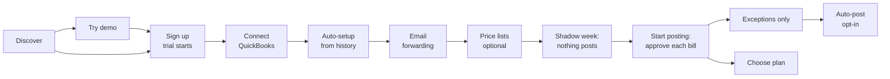
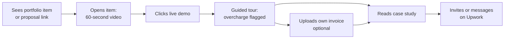

# 02 · Customer journey

Two journeys matter:

- **Part 1: the customer.** A self-serve journey from first visit to auto-posting, with **no human from our side at any step**. Wherever a customer could get stuck, the product detects it and helps, by email or in the app.
- **Part 2: the portfolio viewer.** An Upwork client deciding whether to hire you. They're the real audience right now.

---

## Part 1: The customer (self-serve)

**Targets:** sign-up to first processed invoice in **under 15 minutes** (median). Connected QuickBooks plus a working email route within 24 hours for **70% or more** of sign-ups.

### 1. Discover
- **Channels when selling** (doc 10): QuickBooks App Store, search pages ("match bills to purchase orders QuickBooks"), bookkeeper referrals, and the Upwork portfolio.
- **The landing page** has two buttons: **Try the live demo** (no sign-up) and **Start free trial**. The headline leads with dollars caught, not "AI".

### 2. Try the demo (optional; see doc 12)
- One click opens a private demo workspace with a fictional distributor's invoices and POs already loaded.
- A three-step guided tour: "This invoice is $65 over the PO" → "Approve a clean one" → "See the QuickBooks bill it creates".
- **Moment of truth:** seeing a specific overcharge flagged, with the dollar amount, within 60 seconds.

### 3. Sign up (target: under 2 minutes)
- Email or Google sign-in; organization name; accept the terms (the version and time are recorded).
- **The trial starts:** 14 days, up to 100 invoices, no card. One trial per QuickBooks company, enforced by realm ID.
- Owners and admins enrol in MFA before connecting QuickBooks.

### 4. Connect QuickBooks
- **Connect to QuickBooks** (Intuit's standard button) → Intuit consent → back to a sync screen: "Reading your vendors, items, open POs and 12 months of bills…" with live progress.
- Messages depend on the edition. Plus or Advanced: "14 open POs found; invoices will be checked against them." Essentials: "Your plan has no purchase orders. We'll check prices against your price lists and your own past bills."
- **Drop-off:** QuickBooks only lets an admin connect apps. **Remedy:** "Not a QuickBooks admin? Invite yours", which sends them an invite to the organization as admin.

### 5. Auto-setup from history (the replacement for a setup call)
Runs automatically after the first sync (details in E13-3 and doc 08):
- Vendor email domains from QuickBooks vendor records and past invoices → vendor aliases
- Each vendor's usual expense account, class and location → vendor defaults
- Line descriptions on past bills → item mappings for each vendor
- Vendors whose bills usually include freight → freight allowed for them
- Unit prices per vendor and item → the price-history baseline

**The user sees a summary:** "Set up 42 of 51 active vendors from your history. 9 vendors have too little history; we'll ask about them when their first invoice arrives." Then they pick a tolerance preset: **Strict** (exact), **Standard** (2% or $25, whichever is less), or **Relaxed** (5% or $100).

### 6. Email forwarding (the step most likely to fail; see E13-4)
The company's address is shown with a copy button: `ap-<random>@in.<yourdomain>`. There are four routes, with tabs:

| Route | What the product does |
|---|---|
| **Gmail / Google Workspace** | Step-by-step forwarding setup. Gmail emails a **confirmation code** to our address; the product catches it and **shows the code on screen within seconds**. Then it gives a ready-to-paste filter built from the vendors' email domains, e.g. `from:(@acmesupply.com OR @boltco.com) has:attachment`. |
| **Microsoft 365 / Outlook** | Inbox rule instructions, plus a warning: Microsoft 365 **blocks automatic forwarding outside the company by default** (error `5.7.520`). If nothing arrives within 30 minutes of the user saying the rule is set up, show the fix: ask IT to allow forwarding for this mailbox (link to Microsoft's article), or use one of the routes below. Forwarding by hand is not blocked. |
| **Ask suppliers to send directly** | A ready-to-send notice the user can paste into their own email: "Please send invoices to …". |
| **Upload or forward by hand** | Drag and drop, or forward individual emails. Always available. |

**Verification:** a live "Waiting for your first email…" panel turns green with "Received: Acme Supply, invoice 10442, $1,284.50" when the first invoice arrives. The step is done when one email comes through a route other than upload.

### 7. Price lists (optional)
Upload a CSV or Excel file in any layout. The product suggests which column is which (SKU, description, unit, price, effective date); the user confirms; a preview shows rows that failed and why. Skipping is fine; price history covers the gap.

### 8. Shadow week (default: first 7 days)
- Invoices are read and checked, but **nothing posts to QuickBooks**. The review queue works, and "approve" means "would post".
- Behind the scenes, AP Agent watches the bills the team keeps entering by hand in QuickBooks (via sync) and matches them to its own results.
- **The shadow comparison report** (in the app, plus a daily email): "Your team entered 38 bills this week. AP Agent had 36 of them ready; 31 matched exactly (vendor, amount, coding); 5 differed (see each). It flagged $640 in price variances on 4 invoices that were entered as billed."
- **Start posting** is offered when at least 20 invoices have been processed with a 60% or better zero-edit rate. The user can start earlier, after a warning.

### 9. Start posting: approve every bill
The clerk works the **Ready** queue with the PDF beside the fields. Approve, and the bill is in QuickBooks within a minute, PDF attached and PO linked. Exceptions sit in their own queue with the reason and the dollar impact.

### 10. Exceptions only
After a few weeks the clerk bulk-approves Ready invoices once a day and spends their time on exceptions. A **daily digest** at 8 AM local time lists new exceptions with dollar impact.

### 11. Auto-post (opt-in)
Offered only when the company meets the readiness bar in doc 08. The admin turns it on, optionally for selected vendors only. It switches itself off if accuracy drops.

### 12. Choose a plan
- In-app banner and emails on trial day 10, 13 and 14. **Choose plan** opens Stripe Checkout; the customer portal handles card, plan changes and **self-serve cancellation**.
- No plan at trial end: processing and posting pause (incoming mail is still stored), data is kept 30 days, and choosing a plan picks up where it left off.

### 13. Expand
More QuickBooks companies under one organization; invite the bookkeeper; Partner plan for bookkeeping firms (doc 10).

### Where self-serve users get stuck, and what the product does

| Signal (detected automatically) | Likely cause | Product response |
|---|---|---|
| Signed up, no QuickBooks connection after 24 hours | Not an admin; unsure what it accesses | Email: what we access and why, plus "invite your QuickBooks admin" |
| Connected, no email received after 48 hours | Forwarding not set up, or blocked by Microsoft 365 | Email with provider-specific troubleshooting and the alternatives |
| Gmail confirmation email received but no invoices after 1 hour | Confirmed, but no filter created | In-app prompt with the generated filter text |
| Shadow zero-edit rate under 40% after 20 invoices | Vendors or items not mapped; unusual layouts | Show the 3 least accurate vendors with one-click fixes |
| Ready queue growing, nobody approving | Reviewer left or lost trust | Email the owner a summary; suggest bulk approve |
| No invoices for 3 business days (after previously active) | Forwarding rule broke | Alert the admins with a re-test button |
| QuickBooks disconnected | Token revoked, or app removed | Pause posting; email a reconnect link |

**Activation** = QuickBooks connected, an email route verified, and 10 invoices processed within 7 days of sign-up. Track it weekly. Below 50%, fix onboarding before anything else.

---

## Part 2: The portfolio viewer (Upwork client)

| Step | What they need | Design rule |
|---|---|---|
| Sees the item in your profile grid | A thumbnail and title that say "QuickBooks" and show a dollar amount | Thumbnail: the exception screen with "+$65.00 over PO" visible at 1000×750 |
| Opens the item | Understands it in 10 seconds | The first 300 characters of the description stand alone; the video's first 5 seconds show the result, not a logo |
| Clicks the live demo | It works on the first click, with no sign-up | Instant workspace; under 5 seconds to load; works on a laptop screen. On a phone, show the video and the case study |
| Tries it | Sees a real check, not a canned animation | The guided tour uses the real review UI. Uploading their own invoice runs real extraction (with quotas) |
| Reads the case study | Evidence that it's built properly | Architecture, accuracy on the test set (labelled as such), security, idempotent posting, audit trail. **No invented clients or results** |
| Decides to contact you | A clear next step on Upwork | **No email, phone or contact form** on the linked pages (Upwork rule). "Invite me to your job on Upwork" is the only call to action |

**Track:** profile views (from Upwork's own stats), demo starts, tour completions, own-invoice uploads, and invites or messages that mention the project.
