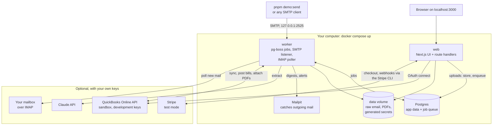
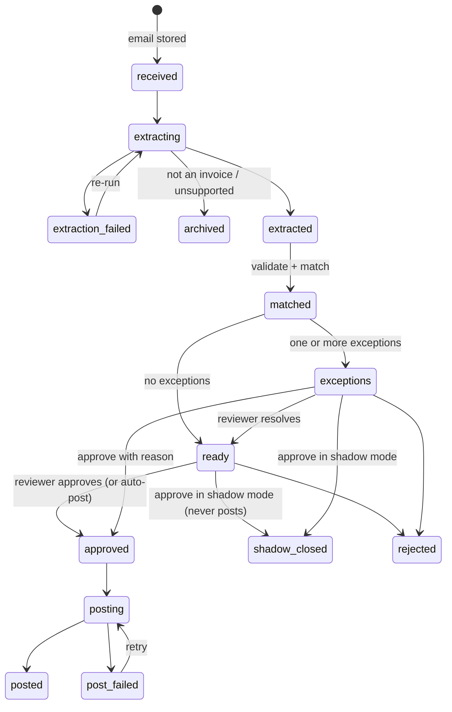
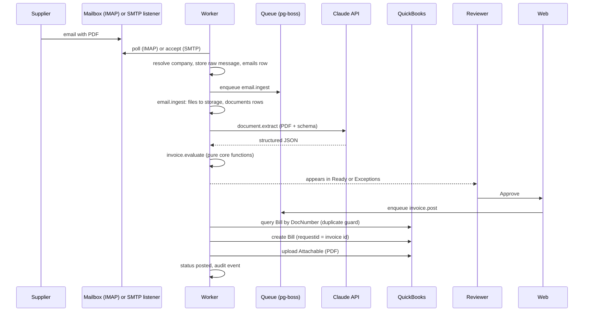

# 04 · Architecture

## Principles (these are rules, not preferences)

1. **The model reads; code decides.** Claude turns documents into structured data. Whether an invoice is clean, which exceptions it has, and whether it may be posted are decided by deterministic, unit-tested functions in `src/core/`. Model output is untrusted data, never an instruction.
2. **Store first, process later.** Every way in (the built-in SMTP listener, IMAP polling, uploads, and the Postmark, Intuit and Stripe webhooks) persists the raw input, enqueues a job, and returns. All work happens in jobs. Every job is idempotent and can be re-run.
3. **Everything that touches the books is traceable.** Every posted bill can be traced to its email, document, extraction, every human edit, the approver, and the QuickBooks response. The `audit_events` table is append-only.
4. **Every query is scoped to a tenant.** Data access goes through repository functions that require `orgId`. A test fails the build if any query on a tenant table skips the scope.
5. **The UI never waits on QuickBooks.** The UI reads our database. QuickBooks is called from jobs only (OAuth callback excepted).
6. **The ledger is an adapter.** Matching and review code know nothing about QuickBooks. There are two adapters from the start: `qbo` (real QuickBooks) and `demo` (the simulated QuickBooks used by the demo company, doc 12). Xero later is a third adapter, not a rewrite.
7. **Money is never a float.** Use `numeric(18,4)` in Postgres and `decimal.js` in TypeScript. Compare with explicit rounding.
8. **Every setup step is self-serve.** If a feature only works after someone on our side configures it, it isn't done. Defaults come from the company's QuickBooks history (auto-setup), and everything else can be fixed in the UI.
9. **Local-first.** `docker compose up` on a laptop, with no accounts and no keys, runs the whole product on the demo company. Every external service sits behind an adapter with a local default: in-app auth instead of a hosted auth service, files on local disk, email through a built-in SMTP listener and a local mail catcher, billing off. Adding a key turns on the real service (Claude, QuickBooks, Stripe) and changes nothing else. Hosting is optional (Phase 7) and runs the same image.

## System diagram



With no keys, nothing in the Optional box is called: the demo company replays stored extractions and posts to the demo ledger. A hosted edition (Phase 7) runs the same image and adds Postmark inbound, object storage and a managed database (see Environments).

## Stack

| Concern | Choice | Why |
|---|---|---|
| Language | TypeScript (strict) everywhere | One language for web, worker and scripts; Claude Code works well with it |
| Web | Next.js (App Router), React Server Components, server actions | One image for UI and API routes |
| UI kit | Tailwind + shadcn/ui; `react-pdf` for the PDF pane | Fast to build, accessible defaults |
| Database | Postgres 16+ (the Docker image locally) | Relational data, `numeric` money, JSONB for raw extraction |
| ORM / migrations | Drizzle | SQL-first, typed, plain migration files |
| Jobs | pg-boss (queue in the same Postgres) | No Redis to run; built-in retries, scheduling and singleton jobs |
| Auth | Better Auth, in our own Postgres: email and password, TOTP two-factor, organizations and roles. **VERIFY** the plugin APIs against its current docs in P1-1 | Runs offline with no third-party account, and whoever runs a copy owns its user data. Replaced Clerk on 2026-11-17 (decisions.md) |
| File storage | Local disk by default (`STORAGE_DRIVER=local`, the data volume); any S3-compatible bucket (`STORAGE_DRIVER=s3`: R2, S3 and others) for a hosted edition | Nothing to set up locally; one interface and short-lived signed URLs either way |
| Email in | A built-in SMTP listener (`smtp-server`) for local testing and the demo; IMAP polling (`imapflow`) of a mailbox you own; uploads. Postmark inbound only in a hosted edition | Works on a laptop with no domain and no MX records |
| Email out | Any SMTP server through `SMTP_URL` (Nodemailer). Locally, Mailpit catches everything at http://localhost:8025 | No email vendor needed to run it |
| MIME parsing | `mailparser` | One parser for every intake route |
| LLM | Claude API, `claude-opus-5-5` by default; optional (without a key, only the demo company's replayed extractions run) | PDF and image input, structured outputs. See `07-integration-email-and-claude.md` |
| Ledger | QuickBooks Online Accounting API, minor version 75+; the demo ledger (simulated) for the demo company | See `06-integration-quickbooks.md` |
| Billing | Stripe Billing in test mode, with a meter for invoice overage. Off unless `BILLING_ENABLED=true` | Built like a live product; a copy you run yourself doesn't need it |
| Errors / logs | `pino` with redaction; Sentry only when `SENTRY_DSN` is set | Redaction is a security requirement |
| Packaging | One Docker image (web and worker run it with different commands) and a `docker-compose.yml` with Postgres and Mailpit. Prebuilt amd64 and arm64 images on GitHub Container Registry (P4-4) | One command to run it; no Node.js needed just to try it |
| Hosting | None by default. A hosted edition (Phase 7) runs the same image on any Docker host | Running cost $0 until someone decides to host it |
| Validation | `zod` at every boundary (webhooks, model output, forms, env) | One schema library everywhere |
| Tests | Vitest (unit and integration), Playwright (a few end-to-end flows, including the quick-start smoke test in CI) | |

## Repository layout

```
.
├── CLAUDE.md
├── README.md                  # product README and quick start
├── LICENSE                    # MIT
├── Dockerfile                 # one image for web and worker
├── docker-compose.yml         # web, worker, Postgres, Mailpit; every port on 127.0.0.1
├── .env.example               # every optional key, empty, with where to get it
├── docs/                      # this kit
├── src/
│   ├── app/                   # Next.js routes
│   │   ├── (app)/             # signed-in UI: inbox, invoice detail, settings, reports
│   │   ├── (admin)/           # instance admin console (E11)
│   │   └── api/
│   │       ├── auth/[...all]/route.ts      # Better Auth handler
│   │       ├── files/[id]/route.ts         # signed, short-lived downloads for the local disk driver
│   │       ├── health/route.ts             # Compose waits on this
│   │       ├── qbo/connect/route.ts, qbo/callback/route.ts
│   │       ├── qbo/webhook/route.ts        # hosted edition only: Intuit webhooks need a public URL
│   │       ├── inbound/postmark/route.ts   # hosted edition only (Phase 7)
│   │       └── stripe/webhook/route.ts     # only when BILLING_ENABLED=true
│   ├── core/                  # PURE domain logic. No I/O, no imports from integrations/ or db/
│   │   ├── money.ts           # decimal helpers, tolerance math
│   │   ├── extraction-schema.ts   # zod schema shared with the Claude call
│   │   ├── validate.ts        # arithmetic + required-field checks (E3-3)
│   │   ├── vendor-resolve.ts  # E5-1
│   │   ├── match.ts           # PO / price list / history matching (E5-2..5)
│   │   ├── fraud-signals.ts   # E5-6
│   │   ├── exceptions.ts      # exception types, messages, dollar impact
│   │   └── route.ts           # decides ready vs exceptions vs auto-post
│   ├── pipeline/              # job handlers: load data, call core, persist, enqueue next
│   ├── onboarding/            # auto-setup inference, email-route detection, shadow comparison (pure logic + jobs)
│   ├── demo/                  # demo company seed, replayed extractions, reset, localhost-only demo sign-in
│   ├── integrations/
│   │   ├── ledger/            # LedgerAdapter interface + qbo/ and demo/ implementations
│   │   ├── claude/            # extraction client (the only file that imports the Anthropic SDK)
│   │   ├── email/             # intake: smtp-listener, imap-poller, postmark; MIME parsing; outbound SMTP
│   │   ├── storage/           # local-disk and s3 drivers behind one interface; signed URLs
│   │   └── stripe/
│   ├── db/
│   │   ├── schema.ts          # Drizzle tables (see 05-data-model.md)
│   │   ├── migrations/
│   │   └── repos/             # tenant-scoped data access; the ONLY place that queries tenant tables
│   ├── worker/index.ts        # pg-boss worker entry; registers handlers and schedules; starts the SMTP listener
│   └── lib/                   # env, crypto (token encryption), first-run secrets, logger, auth helpers, audit
├── scripts/
│   ├── proof-run.ts           # Phase 0: demo dataset or a folder of PDFs + price CSV -> Overcharge Report
│   ├── eval.ts                # extraction eval against fixtures/
│   ├── make-fixtures.ts       # synthetic eval invoices -> fixtures/invoices + expected/
│   ├── make-demo-dataset.ts   # deterministic generator for fixtures/demo
│   ├── demo-send.ts           # emails the demo invoices to the SMTP listener (pnpm demo:send)
│   ├── send-invoice.ts        # emails any file to the SMTP listener (pnpm send-invoice)
│   ├── seed-qbo-sandbox.ts    # demo dataset -> dedicated QuickBooks sandbox company
│   └── reset-qbo-sandbox.ts   # remove Line Beagle bills, recreate used-up POs
├── fixtures/                  # SYNTHETIC data only. Never customer data.
│   ├── invoices/, expected/   # eval set
│   └── demo/                  # Harbor Lane Supply: company, vendors, POs, history, 20 scenario invoices and their stored extractions (doc 12)
└── tests/                     # integration + e2e
```

`src/core/` is the product's value. It must stay pure so it can be unit-tested thoroughly, reused by `scripts/proof-run.ts` in Phase 0, and reasoned about safely.

## The pipeline

### Document and invoice states



`documents` carry `received → extracting → extracted | extraction_failed | archived`. Each extracted invoice is an `invoices` row carrying `matched → ready | exceptions → approved → posting → posted | post_failed`, or `rejected`. In shadow mode, approving moves an invoice to `shadow_closed`: it counts toward accuracy but is never posted, even after the company starts posting (the team already entered it by hand). See `05-data-model.md`.

### Jobs

| Job | Trigger | Does | Idempotency key |
|---|---|---|---|
| `email.poll_imap` | every 2 min per connected mailbox | Fetch messages above the last seen UID (read-only), store each raw message, create `emails`, enqueue `email.ingest` | mailbox + `UIDVALIDITY` + UID |
| `email.ingest` | any intake route: SMTP listener, IMAP poll, Postmark webhook | Store attachments, create `documents`, enqueue `document.extract` | `emails.id` (arrivals are already deduplicated on company + provider + message ID) |
| `document.extract` | after ingest; manual re-run | One Claude call: classify, split, extract (for the demo company, the stored extraction for that file instead, `model = replay`). Save raw JSON, create `invoices` + `invoice_lines` | `document_id` + `extraction_version` |
| `invoice.evaluate` | after extract; after any edit; after reference data changes for a company with open items | `core/validate` → `core/vendor-resolve` → `core/match` → `core/fraud-signals` → `core/route`. Write exceptions and match results | `invoice_id` + `revision` |
| `invoice.post` | approval; auto-post | Through the company's ledger adapter (QuickBooks or demo): pre-post duplicate check, create the bill, attach the PDF, link PO lines, store the bill ID | `invoice_id` (also used as the QuickBooks `requestid`) |
| `company.sync` | connect; every 30 min (CDC); nightly full sync of open POs | Update the reference-data cache; count read calls | singleton per company |
| `company.backfill_history` | connect | Last 12 months of bills → `price_history`, `ref_bills`, `ref_bill_lines` | singleton per company |
| `digest.send` | daily 8 AM company time | E8-1 | company + date |
| `usage.report` | daily, only when billing is on | Report invoice counts to the Stripe meter | org + date |
| `monitor.health` | every 15 min | Silent-inbox, disconnect and failure-rate alerts (E8-2) | singleton |
| `company.auto_setup` | after the first sync and backfill; on demand | Infer aliases, vendor defaults, item mappings and allowed fees from history (E13-3, doc 08) | singleton per company |
| `company.shadow_compare` | after each CDC sync that sees new bills, while in shadow mode | Match bills entered by hand in QuickBooks to our invoices (E13-6) | company + CDC window |
| `onboarding.nudges` | hourly | Detect stuck signals and send lifecycle emails once each (E13-7) | company + signal |
| `trial.check` | hourly, only when billing is on | End trials by date or invoice count; pause processing (E10-1) | org |
| `demo.reset` | on demand (Settings or `pnpm demo:reset`) | Delete the demo company's rows and files, reseed it from `fixtures/demo`, resend its invoices (E14-1) | singleton |

### Happy path, end to end



For the demo company, the Claude call is replaced by the stored extraction and QuickBooks by the demo ledger. Everything else is the same code.

## Concurrency and failure rules

- **QuickBooks token refresh:** refresh only inside a transaction holding `SELECT ... FOR UPDATE` on the company's token row. Persist the new refresh token *before* using the new access token. Concurrent refreshes would otherwise rotate the token twice and break the connection.
- **QuickBooks rate limits:** at most 4 concurrent QuickBooks requests per company (Intuit's limit is 10 per app per company). On 429 or 5xx, back off exponentially with jitter, up to 5 tries.
- **Claude API:** on 429 or 529, back off and retry. Check `stop_reason` before reading output. A refusal or schema failure marks the document `extraction_failed` with a reason; it is never partially saved.
- **Dead letters:** jobs that exhaust their retries land in a `failed` state that is visible in the admin console, with the error and a "re-run" button.
- **Reference data changes:** when a sync changes a vendor, item or open PO, re-evaluate that company's invoices in `ready` and `exceptions`. Matching can change when the PO changes.
- **A copy that was switched off:** scheduled jobs run only while the worker is up. On start, the worker runs any sync that's due. If the last sync is older than the window Intuit's CDC covers (**VERIFY** in P1-8; reported as 30 days), it runs a full sync instead, and the digest skips the days it missed.

## Environments

| Where | Database | QuickBooks | Email | Notes |
|---|---|---|---|---|
| **Local** (the default) | Postgres in Docker | The demo ledger for the demo company; your sandbox companies through your own development keys | SMTP listener on 127.0.0.1:2525; IMAP when you connect a mailbox; outgoing mail to Mailpit (localhost:8025) | `docker compose up` for everything, or `docker compose up -d db mail` plus `pnpm dev` and `pnpm worker` to develop. Videos are recorded here |
| **CI** (GitHub Actions) | Postgres service | The demo ledger only. No secrets | SMTP listener | `pnpm check` on every push; the quick-start smoke test (P4-4) from a clean checkout with no keys |
| **Hosted edition** (Phase 7, optional) | Managed Postgres with point-in-time recovery | Production keys (Intuit's app assessment; HTTPS redirect URIs) | Postmark inbound on your domain, or IMAP; any SMTP provider out | Any Docker host, same image, S3-compatible storage. Its own keys and data; shares nothing with a local copy. Adds Cloudflare Turnstile on sign-up and cookie-less analytics on its marketing pages |

**Running cost:** $0, apart from Claude usage under your own key (set a monthly spend limit in the Anthropic Console; P0-1 set $20). QuickBooks development keys, Stripe test mode, and GitHub with its container registry for a public repo cost nothing. A hosted edition adds hosting, a domain and Postmark.

### First run

What `docker compose up` does on an empty data volume and database:

1. **Postgres and Mailpit** start. Every published port is bound to 127.0.0.1.
2. **Migrations** run once, under a Postgres advisory lock, before the web and worker start serving.
3. **Secrets:** if `AUTH_SECRET`, `TOKEN_ENCRYPTION_KEYS` or `REMIT_HASH_KEY` aren't set, random values are generated once into the data volume (readable only by the app user) and reused on every later start. No secret has a default value anywhere in the repo (CLAUDE.md rule 11).
4. **The demo company:** if no demo organization exists, it's seeded from `fixtures/demo` with its demo user, and the same code as `pnpm demo:send` emails the 20 invoices to the SMTP listener, so they arrive the way real mail does (E14-1).
5. **Ready** when `/api/health` returns 200; Compose waits on it. The README's quick start is exactly this, and CI runs it on every pull request (P4-4).

### Before deploying a copy anywhere else

Turn off `DEMO_LOGIN`; set `APP_URL` to the real HTTPS address; set your own secrets (or keep the generated ones safe) and a strong database password; close sign-ups after your organization exists (`SIGNUPS_ENABLED=false`); point `SMTP_URL` at a real provider. Doc 09 (T11) explains why each matters.

## Phase 0 runs on the same core

`scripts/proof-run.ts` imports `src/core/*` and `src/integrations/claude/` directly, with no database or web. That way the rules you tune on the demo dataset and on real invoices in Phase 0 are the product's rules, not throwaway code. The script itself is throwaway; the core and `fixtures/demo/` are not.
