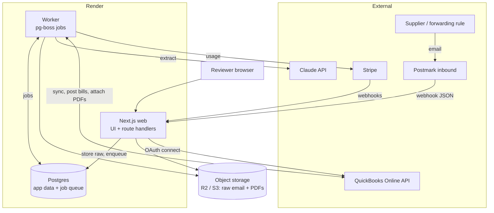
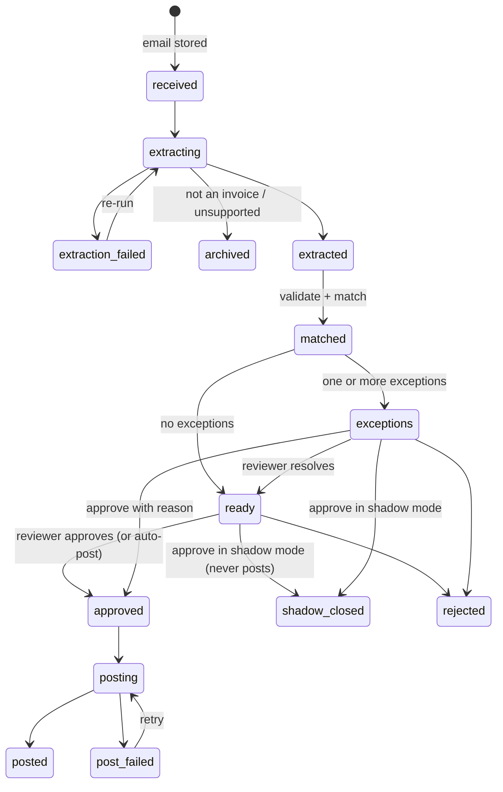
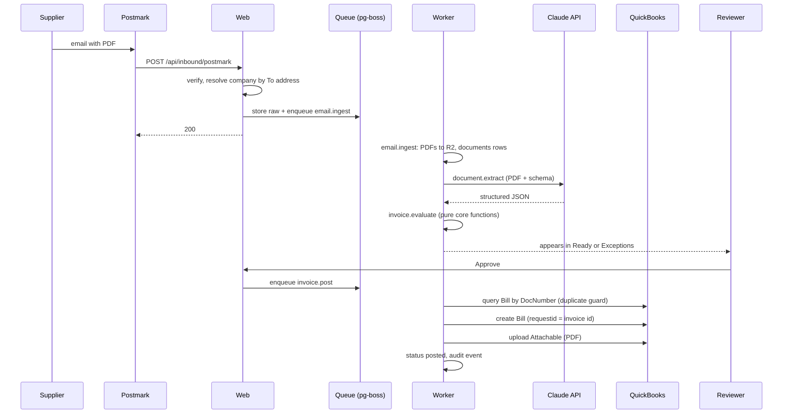

# 04 · Architecture

## Principles (these are rules, not preferences)

1. **The model reads; code decides.** Claude turns documents into structured data. Whether an invoice is clean, which exceptions it has, and whether it may be posted are decided by deterministic, unit-tested functions in `src/core/`. Model output is untrusted data, never an instruction.
2. **Store first, process later.** Webhooks (email, Intuit, Stripe) persist the raw payload, enqueue a job, and return 200. All work happens in jobs. Every job is idempotent and can be re-run.
3. **Everything that touches the books is traceable.** Every posted bill can be traced to its email, document, extraction, every human edit, the approver, and the QuickBooks response. The `audit_events` table is append-only.
4. **Every query is scoped to a tenant.** Data access goes through repository functions that require `orgId`. A test fails the build if any query on a tenant table skips the scope.
5. **The UI never waits on QuickBooks.** The UI reads our database. QuickBooks is called from jobs only (OAuth callback excepted).
6. **The ledger is an adapter.** Matching and review code know nothing about QuickBooks. There are two adapters from the start: `qbo` (real QuickBooks) and `demo` (the simulated QuickBooks behind the public demo, doc 12). Xero later is a third adapter, not a rewrite.
7. **Money is never a float.** Use `numeric(18,4)` in Postgres and `decimal.js` in TypeScript. Compare with explicit rounding.
8. **Every setup step is self-serve.** If a feature only works after someone on our side configures it, it isn't done. Defaults come from the company's QuickBooks history (auto-setup), and everything else can be fixed in the UI.

## System diagram



## Stack

| Concern | Choice | Why |
|---|---|---|
| Language | TypeScript (strict) everywhere | One language for web, worker and scripts; Claude Code works well with it |
| Web | Next.js (App Router), React Server Components, server actions | One deployable unit for UI and API routes |
| UI kit | Tailwind + shadcn/ui; `react-pdf` for the PDF pane | Fast to build, accessible defaults |
| Database | Postgres 16+ | Relational data, `numeric` money, JSONB for raw extraction |
| ORM / migrations | Drizzle | SQL-first, typed, plain migration files |
| Jobs | pg-boss (queue in the same Postgres) | No Redis to run; built-in retries, scheduling and singleton jobs |
| Auth | Clerk with Organizations and MFA | Org and role model, MFA without building it. Alternative: Better Auth, if you want auth in your own database |
| Object storage | Cloudflare R2 (S3 API) | No egress fees; private buckets; signed URLs |
| Inbound + outbound email | Postmark (Pro plan, for inbound) | Inbound webhook parses attachments; one vendor for both directions |
| LLM | Claude API, `claude-opus-5-5` by default | PDF and image input, structured outputs. See `07-integration-email-and-claude.md` |
| Ledger | QuickBooks Online Accounting API, minor version 75+ | See `06-integration-quickbooks.md` |
| Billing | Stripe Billing, with a meter for invoice overage | Standard; usage-based add-on |
| Errors / logs | Sentry; `pino` with redaction | Redaction is a security requirement |
| Hosting | Render: web service + background worker + managed Postgres | One place for all three; simple for a solo founder |
| Bot protection (demo, sign-up) | Cloudflare Turnstile | Stops scripted demo-workspace and trial creation |
| Analytics (demo, marketing pages) | A privacy-friendly, cookie-less tool (e.g. Plausible) | Demo funnel without ad trackers |
| Validation | `zod` at every boundary (webhooks, model output, forms, env) | One schema library everywhere |
| Tests | Vitest (unit and integration), Playwright (a few end-to-end flows) | |

## Repository layout

```
.
├── CLAUDE.md
├── docs/                      # this kit
├── src/
│   ├── app/                   # Next.js routes
│   │   ├── (app)/             # signed-in UI: inbox, invoice detail, settings, reports
│   │   ├── (admin)/           # internal ops console (E11)
│   │   └── api/
│   │       ├── inbound/postmark/route.ts
│   │       ├── qbo/connect/route.ts, qbo/callback/route.ts, qbo/webhook/route.ts
│   │       └── stripe/webhook/route.ts
│   ├── core/                  # PURE domain logic. No I/O, no imports from integrations/ or db/
│   │   ├── money.ts           # decimal helpers, tolerance math
│   │   ├── extraction-schema.ts   # zod schema shared with the Claude call
│   │   ├── validate.ts        # arithmetic + required-field checks (E3-3)
│   │   ├── vendor-resolve.ts  # E5-1
│   │   ├── match.ts           # PO / price list / history matching (E5-2..5)
│   │   ├── fraud-signals.ts   # E5-6
│   │   ├── exceptions.ts      # exception types, messages, dollar impact
│   │   └── route.ts           # decides ready vs exceptions vs auto-post
│   ├── pipeline/              # job handlers: load data, call core, persist, enqueue next
│   ├── onboarding/            # auto-setup inference, email-route detection, shadow comparison (pure logic + jobs)
│   ├── demo/                  # demo workspace seeding, quotas, cleanup (only active when DEMO_MODE=true)
│   ├── integrations/
│   │   ├── ledger/            # LedgerAdapter interface + qbo/ and demo/ implementations
│   │   ├── claude/            # extraction client (the only file that imports the Anthropic SDK)
│   │   ├── email/             # Postmark inbound parsing, outbound sending
│   │   ├── storage/           # R2 client, signed URLs
│   │   └── stripe/
│   ├── db/
│   │   ├── schema.ts          # Drizzle tables (see 05-data-model.md)
│   │   ├── migrations/
│   │   └── repos/             # tenant-scoped data access; the ONLY place that queries tenant tables
│   ├── worker/index.ts        # pg-boss worker entry; registers handlers and schedules
│   └── lib/                   # env, crypto (token encryption), logger, auth helpers, audit
├── scripts/
│   ├── proof-run.ts           # Phase 0: demo dataset or a folder of PDFs + price CSV -> Overcharge Report
│   ├── eval.ts                # extraction eval against fixtures/
│   ├── make-fixtures.ts       # synthetic eval invoices -> fixtures/invoices + expected/
│   ├── make-demo-dataset.ts   # deterministic generator for fixtures/demo
│   ├── seed-qbo-sandbox.ts    # demo dataset -> dedicated QuickBooks sandbox company
│   └── reset-qbo-sandbox.ts   # remove AP Agent bills, recreate used-up POs
├── fixtures/                  # SYNTHETIC data only. Never customer data.
│   ├── invoices/, expected/   # eval set
│   └── demo/                  # Harbor Lane Supply: company, vendors, POs, history, 20 scenario invoices (doc 12)
└── tests/                     # integration + e2e
```

`src/core/` is the product's value. It must stay pure so it can be unit-tested thoroughly, reused by `scripts/proof-run.ts` in Phase 0, and reasoned about safely.

## The pipeline

### Document and invoice states



`documents` carry `received → extracting → extracted | extraction_failed | archived`. Each extracted invoice is an `invoices` row carrying `matched → ready | exceptions → approved → posting → posted | post_failed`, or `rejected`. In shadow mode, approving moves an invoice to `shadow_closed`: it counts toward accuracy but is never posted, even after the company starts posting (the team already entered it by hand). See `05-data-model.md`.

### Jobs

| Job | Trigger | Does | Idempotency key |
|---|---|---|---|
| `email.ingest` | Postmark webhook | Store attachments in R2, create `documents`, enqueue `document.extract` | Postmark `MessageID` |
| `document.extract` | after ingest; manual re-run | One Claude call: classify, split, extract. Save raw JSON, create `invoices` + `invoice_lines` | `document_id` + `extraction_version` |
| `invoice.evaluate` | after extract; after any edit; after reference data changes for a company with open items | `core/validate` → `core/vendor-resolve` → `core/match` → `core/fraud-signals` → `core/route`. Write exceptions and match results | `invoice_id` + `revision` |
| `invoice.post` | approval; auto-post | Pre-post duplicate check in QuickBooks, create the bill, attach the PDF, link PO lines, store the bill ID | `invoice_id` (also used as the QuickBooks `requestid`) |
| `company.sync` | connect; every 30 min (CDC); nightly full sync of open POs | Update the reference-data cache; count read calls | singleton per company |
| `company.backfill_history` | connect | Last 12 months of bills → `price_history`, `ref_bills`, `ref_bill_lines` | singleton per company |
| `digest.send` | daily 8 AM company time | E8-1 | company + date |
| `usage.report` | daily | Report invoice counts to the Stripe meter | org + date |
| `monitor.health` | every 15 min | Silent-inbox, disconnect and failure-rate alerts (E8-2) | singleton |
| `company.auto_setup` | after the first sync and backfill; on demand | Infer aliases, vendor defaults, item mappings and allowed fees from history (E13-3, doc 08) | singleton per company |
| `company.shadow_compare` | after each CDC sync that sees new bills, while in shadow mode | Match bills entered by hand in QuickBooks to our invoices (E13-6) | company + CDC window |
| `onboarding.nudges` | hourly | Detect stuck signals and send lifecycle emails once each (E13-7) | company + signal |
| `trial.check` | hourly | End trials by date or invoice count; pause processing (E10-1) | org |
| `demo.cleanup` | hourly, demo environment only | Delete expired demo workspaces and their uploads (E14-1) | singleton |

### Happy path, end to end



## Concurrency and failure rules

- **QuickBooks token refresh:** refresh only inside a transaction holding `SELECT ... FOR UPDATE` on the company's token row. Persist the new refresh token *before* using the new access token. Concurrent refreshes would otherwise rotate the token twice and break the connection.
- **QuickBooks rate limits:** at most 4 concurrent QuickBooks requests per company (Intuit's limit is 10 per app per company). On 429 or 5xx, back off exponentially with jitter, up to 5 tries.
- **Claude API:** on 429 or 529, back off and retry. Check `stop_reason` before reading output. A refusal or schema failure marks the document `extraction_failed` with a reason; it is never partially saved.
- **Dead letters:** jobs that exhaust their retries land in a `failed` state that is visible in the admin console, with the error and a "re-run" button.
- **Reference data changes:** when a sync changes a vendor, item or open PO, re-evaluate that company's invoices in `ready` and `exceptions`. Matching can change when the PO changes.

## Environments

| Env | Database | QuickBooks | Email | Notes |
|---|---|---|---|---|
| local | Docker Postgres | Intuit sandbox company | Replay fixture webhook JSON; a tunnel only when testing live | `pnpm dev` + `pnpm worker` |
| staging | Render Postgres (small) | Dedicated demo sandbox company (doc 12) | Postmark test server, separate inbound domain | Deployed from `main`; used for recordings and the nightly end-to-end test |
| **demo** (public) | Its own Render Postgres | Development keys only; public visitors use the demo ledger | Its own Postmark server, `in-demo.` subdomain | `DEMO_MODE=true`; Stripe test keys; its own Claude key with a spend limit. Never shares a database, bucket or key with any other environment |
| production (Phase 7 only) | Render Postgres with PITR backups | Production keys | Postmark live server | Deployed from tagged releases |

Expected infrastructure cost before going live (staging + demo): roughly $90 to $180 a month (two sets of Render web, worker and Postgres; Postmark Pro; a domain), plus the demo's capped model spend. Sentry, Clerk, Turnstile and R2 start on free tiers; check each one's current limits.

## Phase 0 runs on the same core

`scripts/proof-run.ts` imports `src/core/*` and `src/integrations/claude/` directly, with no database or web. That way the rules you tune on the demo dataset and on real invoices in Phase 0 are the product's rules, not throwaway code. The script itself is throwaway; the core and `fixtures/demo/` are not.
