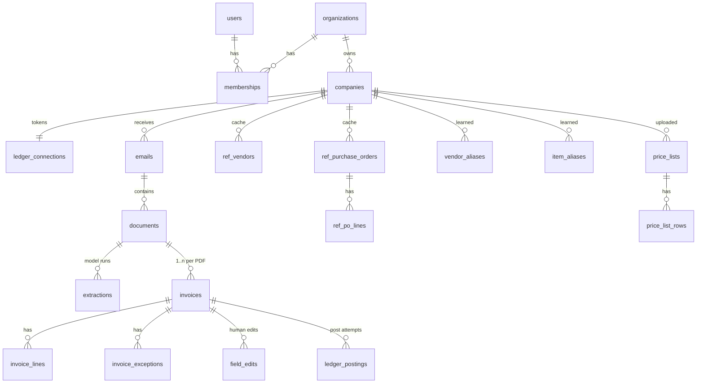

# 05 · Data model

Postgres, managed through Drizzle. This is the logical model; `src/db/schema.ts` is the source of truth once it exists. Keep this doc updated when the schema changes in a way that affects meaning.

**Conventions**
- Primary keys are `uuid` (v7, so they sort by time), except `audit_events`, which uses `bigserial`.
- **Every tenant table has `org_id`**, and every table about one QuickBooks file also has `company_id`. Repos in `src/db/repos/` require both.
- Money and quantities use `numeric(18,4)`. Never `real` or `double`.
- Timestamps are `timestamptz`; invoice dates are `date`. The company time zone lives on `companies`.
- Columns ending `_ledger_id` hold QuickBooks IDs (strings). Reference tables use the composite key `(company_id, ledger_id)`.
- `raw` JSONB columns keep the original payload for debugging. They are excluded from logs.



---

## Tenancy and access

**organizations**
```
id, name, kind enum('customer','demo'), clerk_org_id (unique, null for demo),
billing_mode enum('stripe','demo'), stripe_customer_id, stripe_subscription_id, plan,
subscription_status enum('trialing','active','past_due','paused','canceled'),
trial_ends_at, trial_invoice_limit int default 100,
terms_version, terms_accepted_at, terms_accepted_by,
expires_at null,                 -- demo workspaces only: created_at + 24h
created_at
```

**users**: `id, clerk_user_id (unique), email, name, created_at`

**memberships**: `org_id, user_id, role enum('owner','admin','reviewer'), created_at`, PK `(org_id, user_id)`

**companies**: one QuickBooks file.
```
id, org_id, name, ledger enum('qbo','demo'), realm_id (unique among qbo companies; null for demo), qbo_edition enum('simple_start','essentials','plus','advanced','unknown'),
timezone, status enum('active','needs_reconnect','disconnected','paused'),
posting_mode enum('shadow','approve','auto') default 'shadow', shadow_until timestamptz,
onboarding jsonb,          -- {connected_at, auto_setup_at, tolerance_chosen_at, email_route, forwarding_verified_at,
                           --  price_list_skipped, first_invoice_at, posting_started_at}
inbox_token (unique), inbox_token_prev, inbox_token_rotated_at,
settings jsonb (see below), support_access_until timestamptz null,
created_at, updated_at
```

**ledger_connections**: kept apart from `companies` so few code paths touch it.
```
company_id PK, access_token_enc bytea, refresh_token_enc bytea, key_version int,
access_expires_at, refresh_expires_at, scopes text[], connected_by user_id, connected_at, last_refresh_at
```
Encryption details are in `09-security-compliance.md`. Only `src/integrations/ledger/qbo/tokens.ts` reads this table.

### `companies.settings` (validated by a zod schema)

```json
{
  "tolerance": { "price_pct": "2.0", "price_abs": "25.00", "qty_pct": "0", "rounding_abs": "0.05" },
  "require_price_source": false,
  "history": { "window_days": 90, "min_samples": 3 },
  "digest": { "recipients": ["ap@customer.com"], "hour_local": 8 },
  "minutes_per_invoice": 4
}
// Auto-post on/off is companies.posting_mode; which vendors may auto-post is vendor_defaults.auto_post_allowed.
```

## Intake

**emails**
```
id, org_id, company_id, provider 'postmark', provider_message_id (unique), from_address, from_domain, to_address,
kind enum('normal','forwarding_confirmation') default 'normal',   -- Gmail confirmation mails are shown in onboarding, never processed
confirmation_code text null,
subject, received_at, spf_result, dkim_result, raw_object_key, attachment_count, created_at
```

**documents**: one per attachment, upload or HTML body.
```
id, org_id, company_id, email_id null, source enum('email','upload','html_body'),
filename, mime_type, size_bytes, sha256, object_key, page_count,
status enum('received','extracting','extracted','extraction_failed','archived'),
doc_type enum('invoice','credit_memo','statement','quote_or_po','receipt','other') null,
archived_reason text null, extraction_attempts int, last_error text, created_at
```
Index `(company_id, sha256)`. If the same file arrives twice, the second one is linked to the first and archived as a duplicate; it is not processed again.

## Extraction and invoices

**extractions**: one row per model call, kept for evals and cost tracking.
```
id, org_id, document_id, model, prompt_version, schema_version, stop_reason,
input_tokens, output_tokens, cost_usd numeric(10,6), latency_ms, raw_output jsonb, error text, created_at
```

**invoices**
```
id, org_id, company_id, document_id, extraction_id, page_from, page_to,
status enum('matched','ready','exceptions','approved','posting','posted','post_failed','rejected','shadow_closed'),
revision int,                                -- bumped on every edit; invoice.evaluate is keyed on it
vendor_name_raw, vendor_ledger_id null,
vendor_resolution enum('alias','email_domain','tax_id','fuzzy','manual') null,
invoice_number, invoice_date, due_date, terms_raw, po_numbers text[], currency char(3),
subtotal, tax, freight, fees, total,           -- numeric(18,4)
remit_to jsonb,                                -- name, address, bank_name, account_last4, account_hmac, routing_hmac (never the full number)
sender_email, matched_po_ledger_id null,
auto_approvable bool,                          -- output of core/route
zero_edit bool null,                           -- set at approval: no field_edits rows
approved_by null, approved_at null, approval_reason text null, auto_posted bool default false,
rejected_reason text null,
ledger_bill_id null, posted_at null,
created_at, updated_at
```
Index `(company_id, status, created_at)` for the queues. Index `(company_id, vendor_ledger_id, invoice_number)` for duplicate checks.

**invoice_lines**
```
id, org_id, invoice_id, line_no,
kind enum('item','freight','fee','tax','discount','other'),
description, supplier_sku, qty, uom, unit_price, amount, po_ref,
-- coding
coded_item_ledger_id, coded_account_ledger_id, class_ledger_id, location_ledger_id, customer_ledger_id,
coding_source enum('po_line','alias','vendor_default','model','manual'),
-- matching
matched_po_line_ledger_id null, price_source enum('po','price_list','history','none'),
expected_unit_price null, variance_amount null, variance_pct null
```

**invoice_exceptions**
```
id, org_id, invoice_id, line_id null,
type enum(see list), severity enum('block','warn'),
message text,                 -- plain words, rendered in the UI
dollar_impact numeric null,
data jsonb,                   -- the numbers behind the message
resolved_by null, resolved_at null, resolution text null,
created_at
```
Exception types (meanings are in `08-matching-engine.md`):
`unknown_vendor, no_po_found, po_ambiguous, line_unmatched, price_variance, qty_over_po, unexpected_fee, uom_unknown, unverified_price, duplicate_suspected, arithmetic_mismatch, missing_required_field, needs_coding_review, credit_memo, remit_to_changed, new_sender, currency_mismatch, low_quality_scan`

**field_edits**: every human change. The zero-edit metric comes from this table.
```
id, org_id, invoice_id, line_id null, field, old_value jsonb, new_value jsonb, user_id, created_at
```

## QuickBooks reference cache (per company)

All have PK `(company_id, ledger_id)`, plus `active bool, sync_token, ledger_updated_at, raw jsonb, synced_at`.

| Table | Key columns |
|---|---|
| `ref_vendors` | display_name, company_name, primary_email, web_addr, tax_id, term_ledger_id |
| `ref_items` | name, sku, type, expense_account_ledger_id, purchase_cost, purchase_desc |
| `ref_accounts` | name, fully_qualified_name, account_type, account_sub_type |
| `ref_classes`, `ref_locations`, `ref_terms` | name |
| `ref_customers` | display_name, is_job, parent_ledger_id |
| `ref_purchase_orders` | vendor_ledger_id, doc_number, txn_date, po_status, total |
| `ref_po_lines` | po_ledger_id, line_ledger_id, item_ledger_id, account_ledger_id, description, qty, unit_price, amount, class_ledger_id, customer_ledger_id, **billed_qty** (computed: from bills linked to the line, plus our own postings) |

**ref_bills**: recent QuickBooks bills, for duplicate checks, auto-setup and shadow mode. `company_id, ledger_id, vendor_ledger_id, doc_number_norm, txn_date, total, department_ledger_id null, linked_po_ledger_ids text[]`. Keep 18 months. Index `(company_id, vendor_ledger_id, doc_number_norm)`.

**ref_bill_lines**: the coding on those bills, read by auto-setup (doc 08). Metered reads make re-reading QuickBooks the expensive option, so keep them. `company_id, bill_ledger_id, line_no, vendor_ledger_id, txn_date, detail_type enum('item','account'), item_ledger_id null, account_ledger_id null, class_ledger_id null, customer_ledger_id null, description_norm, qty null, unit_price null, amount`. Kept as long as the bill. Index `(company_id, vendor_ledger_id, txn_date desc)`.

**price_history**: from the company's bills in QuickBooks, used when there is no PO or price list.
```
company_id, vendor_ledger_id, item_ledger_id null, description_norm, unit_price, qty, txn_date, bill_ledger_id
```
Index `(company_id, vendor_ledger_id, item_ledger_id, txn_date desc)`.

**sync_state**: `company_id, entity, last_cdc_at, last_full_at`

## Learned rules and configuration

These tables are the product's memory. They are what makes a customer's account better every week, so they're worth protecting.

**vendor_aliases**: `company_id, alias_type enum('name','email_domain','email_address','tax_id'), value_norm, vendor_ledger_id, source enum('auto','learned','manual'), created_by null, created_at`. Unique `(company_id, alias_type, value_norm)`. `email_address` is used only for free-mail senders.

Rule sources, for every table in this section: `auto` was made by auto-setup (doc 08), `learned` by a reviewer's "Always do this", and `manual` in Settings → Rules. Auto-setup never changes `learned` or `manual` rules.

**item_aliases**: `company_id, vendor_ledger_id, supplier_sku null, description_norm null, item_ledger_id null, account_ledger_id null, invoice_uom null, uom_factor numeric default 1, source enum('auto','learned','manual'), created_by null, created_at`. A `uom_factor` of 12 means one invoice unit (case) equals 12 ledger units (each).

**vendor_defaults**: `company_id, vendor_ledger_id, default_account_ledger_id, default_class_ledger_id, default_location_ledger_id, allowed_fee_kinds text[], tolerance_override jsonb null, auto_post_allowed bool default true, source enum('auto','learned','manual'), updated_by null, updated_at`. Once a person edits any field, the row's source stops being `auto` and auto-setup leaves the whole row alone. `auto_post_allowed` is the auto-post vendor allow-list (E12-1).

**price_lists**: `id, company_id, vendor_ledger_id, version, effective_from, effective_to null, source_filename, uploaded_by, uploaded_at`
**price_list_rows**: `price_list_id, supplier_sku null, description_norm null, item_ledger_id null, uom, unit_price`

## Posting, audit and usage

**ledger_postings**: one row per attempt.
```
id, org_id, company_id, invoice_id, request_id, attempt, http_status, ledger_bill_id null,
error_code null, error_message null, request_redacted jsonb, created_at
```

**audit_events**: append-only. The app's database role has `INSERT` and `SELECT` only on this table.
```
id bigserial, org_id, company_id null, actor_type enum('user','system','support'), actor_id,
action text,          -- e.g. invoice.approved, invoice.field_edited, company.connected, auto_post.enabled, support.viewed_invoice
entity_type, entity_id, data jsonb, created_at
```

**usage_daily**: `org_id, company_id, date, invoices_extracted, documents_received, model_cost_usd, qbo_read_calls`. Feeds billing (E10), trial limits, the admin console (E11), cost tracking, and the demo's global daily caps (sum over `kind = demo` organizations).

## Onboarding, shadow mode and the demo

**shadow_matches**: one row per bill the team entered by hand during shadow mode (E13-6).
```
id, org_id, company_id, ledger_bill_id, invoice_id null,
match enum('exact','differs','ours_only','ledger_only'),
differences jsonb,          -- field-by-field: vendor, total, lines, coding
flagged_dollars numeric null, created_at
```

**onboarding_events**: `org_id, company_id, signal, sent_at`. Stuck signals and lifecycle emails (E13-7); unique `(company_id, signal)` so each email goes once.

**demo_bills**: the simulated ledger's posted bills (demo environment only).
```
company_id, ledger_id, invoice_id, payload jsonb (exactly what the QuickBooks adapter would send), created_at
```
The demo ledger reads vendors, items, POs and history from the normal `ref_*` tables, seeded from `fixtures/demo` with `ledger = 'demo'`.

## Retention

| Data | Kept | Why |
|---|---|---|
| Raw emails and PDFs in R2 | 13 months, then deleted (configurable per org) | The PDF is also attached to the bill in QuickBooks, so we are not the system of record |
| Invoices, lines, exceptions, edits, audit events | While the org is active, plus 90 days after cancellation | Audit trail |
| QuickBooks reference cache and price history | Deleted within 30 days of disconnect | Intuit asks apps not to keep QuickBooks data beyond what they need |
| Tokens | Deleted immediately on disconnect or revocation | |
| Demo workspaces (`kind = demo`) | Deleted with all rows and uploaded files at `expires_at` (24 hours) | Visitors may upload real documents |
| Ended trials with no plan | Processing paused; data kept 30 days, then deleted | E10-1 |
| `extractions.raw_output` | 13 months | Evals and debugging |
